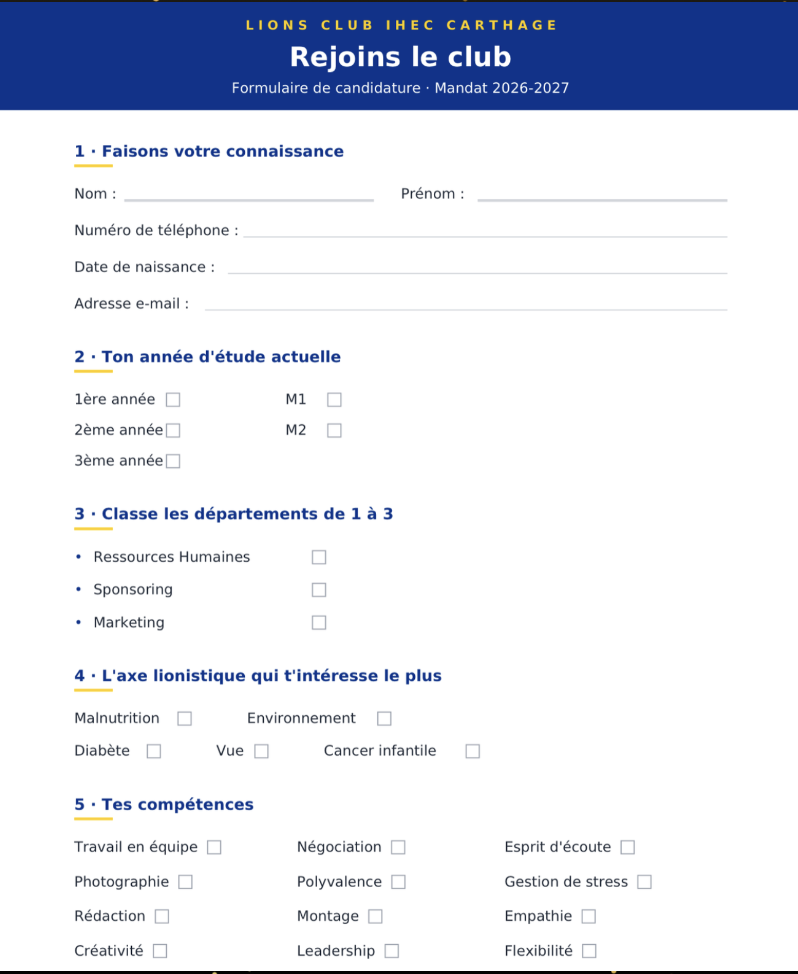
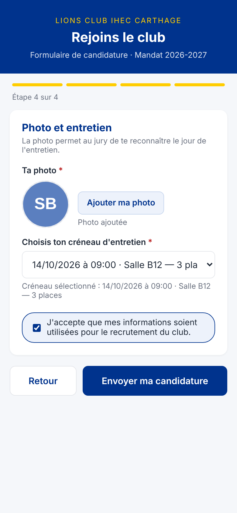
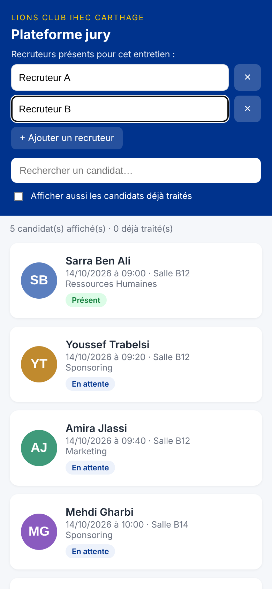
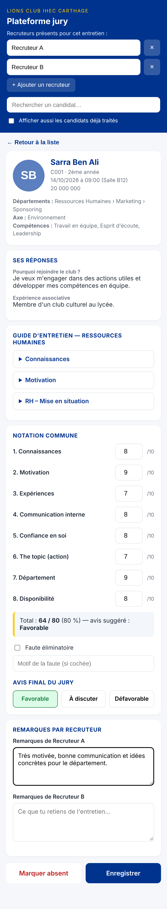
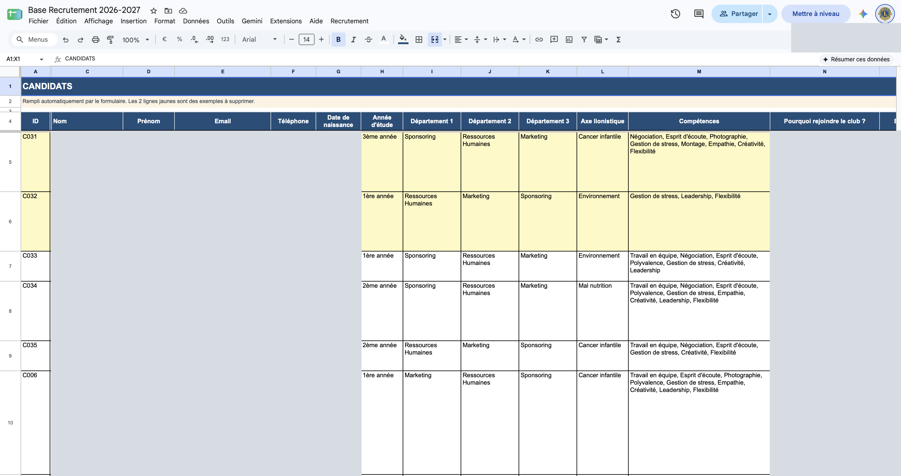
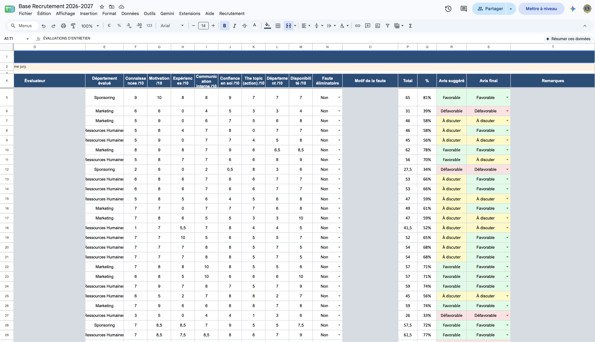
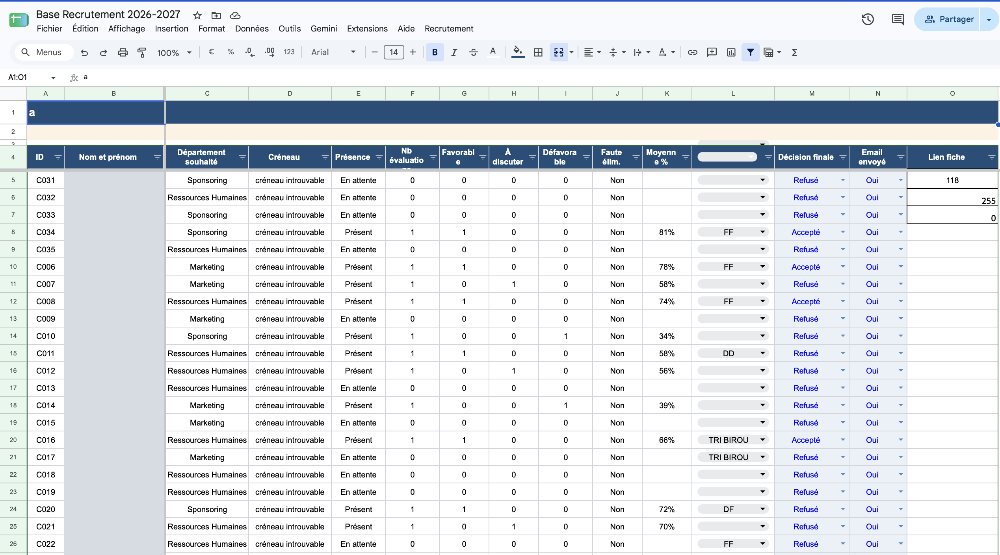
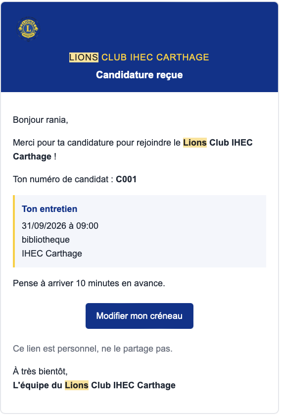
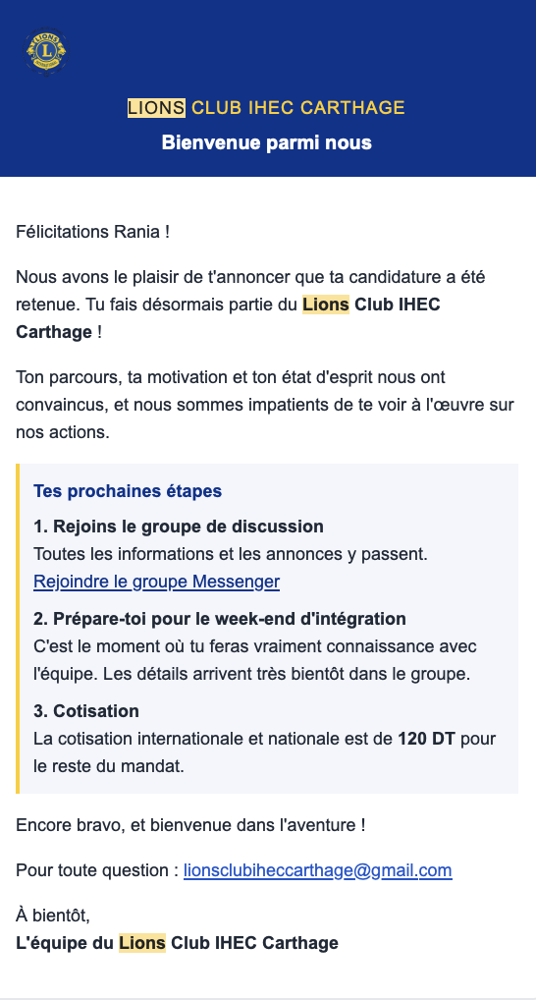
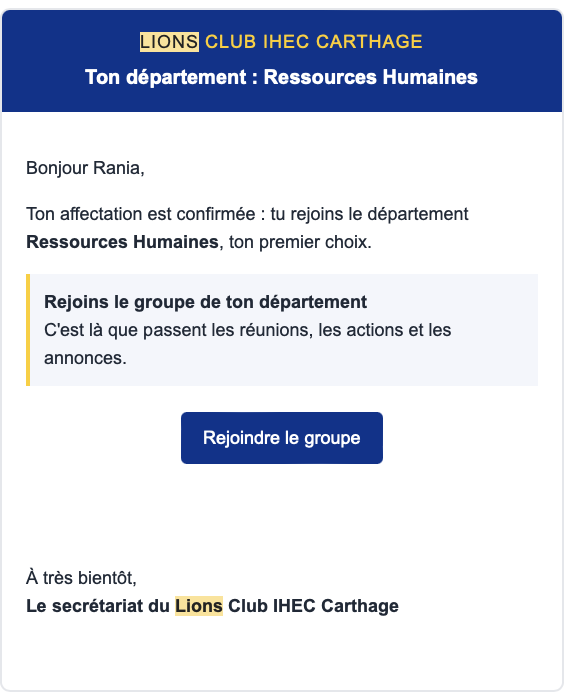

# Plateforme de recrutement digitale – Lions Club IHEC Carthage

Plateforme développée pour digitaliser le recrutement des nouveaux membres du Lions Club IHEC Carthage (mandat 2026-2027), en remplacement des fiches d'évaluation papier.

**Utilisée en conditions réelles : 340 candidatures traitées.**

## Problème de départ

Les évaluateurs notaient les candidats sur papier, puis le bureau devait regrouper et trier les fiches à la main : un processus long, difficile à comparer et source d'erreurs.

## Fonctionnalités

- **Formulaire de candidature en 4 étapes** (application web), avec photo, choix des départements et réservation d'un créneau d'entretien en temps réel selon les places restantes
- **Email de confirmation automatique** avec un lien personnel et sécurisé pour modifier son créneau
- **Plateforme jury** : liste des candidats du jour, fiche complète de chaque candidat, guide d'entretien adapté au département, notation sur 8 critères et avis Favorable / À discuter / Défavorable
- **Tableau de bord** dans Google Sheets : moyennes, nombre d'avis et décision provisoire pour chaque candidat
- **Rappels automatiques** envoyés la veille de chaque entretien
- **Envoi des résultats** par email (acceptation, liste d'attente, refus), avec confirmation avant envoi
- **Gestion des accès concurrents** (verrou) pour éviter les doubles réservations quand plusieurs candidats s'inscrivent en même temps

## Technologies

- Google Apps Script (JavaScript)
- Google Sheets (base de données)
- HTML / CSS (interfaces web adaptées au mobile)
- Gmail et Google Drive (emails et stockage des photos)

## Structure du projet

| Fichier | Rôle |
|---|---|
| `src/Code.gs` | Logique serveur : pages web, enregistrement des candidatures, créneaux, évaluations, emails |
| `src/Candidature.html` | Formulaire de candidature |
| `src/Creneau.html` | Page de modification du créneau |
| `src/Jury.html` | Plateforme d'évaluation pour le jury |

## Configuration

Avant de déployer le projet, renseigner dans `Code.gs` :

- `DOSSIER_PHOTOS_ID` : l'ID du dossier Google Drive qui reçoit les photos
- `CLE_SECRETE` : une chaîne secrète servant à sécuriser les liens personnels
- `LIEN_GROUPE` : le lien du groupe de discussion des nouveaux membres

## Mon rôle

En tant qu'Adjointe Secrétaire du club, j'ai conçu et développé l'ensemble de la plateforme, formé les recruteurs à son utilisation, puis assuré son suivi pendant toute la période de recrutement.

## Aperçu

*Les données personnelles des candidats et des évaluateurs ont été masquées. Les captures du formulaire en ligne et de la plateforme jury utilisent des données fictives.*

### Avant / après : la candidature
| Avant : formulaire papier | Après : formulaire en ligne (mobile) |
|---|---|
|  |  |

### Plateforme jury (mobile)
| Liste des candidats du jour | Fiche d'évaluation |
|---|---|
|  |  |

### Base des candidats

### Évaluations du jury

### Tableau de bord et décisions

### Emails automatiques
| Confirmation de candidature | Acceptation | Affectation au département |
|---|---|---|
|  |  |  |

---

Les données réelles des candidats ne sont pas publiées.
